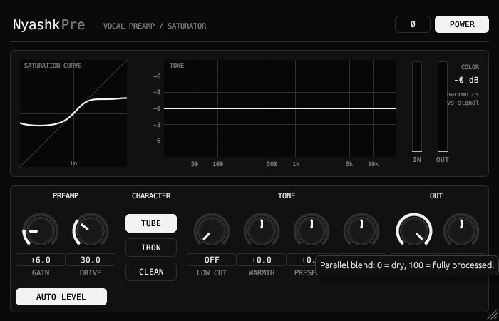

<div align="center">

# NyashkPre

Light vocal preamp / saturator VST3 plugin with tube, iron and clean character and a tone section.

[](https://github.com/xslimakx/NyashkPre/actions/workflows/build.yml)
[](LICENSE)


[**Download**](https://github.com/xslimakx/NyashkPre/releases/latest)

</div>

<p align="center"></p>

## Install
Use the Nyashk Launcher, or unzip the `.vst3` bundle from the latest release into your VST3 folder.

## Build
```
cargo xtask bundle -p nyashkpre --release
```
The bundle appears in `target/bundled/`.

## License
MIT
